<p align="center">
  
</p>

# AccessiPay

**Zero violations. Zero purchases.** Accessibility scanners check rules. AccessiPay checks the outcome: it sends a shopper who cannot see the screen, a shopper who cannot use a mouse, and an AI shopping agent to buy, and only an order PayPal confirms counts as success. When a shopper gets stuck, AI patches the page and the same shopper tries again.

Built for the **PayPal AI Hackathon 2026** by Stanislav Gatin.

<p align="center">
  <a href="https://youtu.be/5SXok5O-q2U"></a>&nbsp;
  <a href="#run-it"></a>&nbsp;
  <a href="#how-paypal-and-ai-are-used"></a>
</p>

<p align="center">
  <a href="#run-it"><b>Run it</b></a> ·
  <a href="#how-it-works">How it works</a> ·
  <a href="#one-case-end-to-end">One case, end to end</a> ·
  <a href="#results">Results</a> ·
  <a href="#test-your-own-shop">Your own shop</a> ·
  <a href="#are-the-findings-real">Are the findings real?</a> ·
  <a href="#what-it-does-not-claim">Limits</a>
</p>

| | |
|---|---|
| **Who shops** | A screen reader user, a keyboard-only user and an AI shopping agent, simulated in a real Chromium |
| **Pass mark** | An order that PayPal (Orders v2, sandbox) reports as `COMPLETED`, with the right item bought. Saying "done" is not enough |
| **When stuck** | The AI fixer reads the page and the record of the visit, writes a patch, and the same customer tries again |
| **The owner gets** | Fixes ranked by who they block, ready code, a replay of every step, a screenshot with the problem circled, an accessible PDF |
| **Start** | `npm install && npx playwright install chromium && npm run build && npm start`, then open http://127.0.0.1:4300 ([Run it](#run-it)) |

> Simulated customers, PayPal sandbox only: no real money moves. Not a WCAG audit or certificate.

## The problem in one minute

A checkout can pass an automated scan and still be impossible to complete. In the demo shop, axe-core (default rules, every page of the flow) flags 2 of 13 real checkout defects. The other 11 include a promo popup that traps the keyboard, a Pay button made of a `<div>`, and form errors hidden from assistive technology. Each of them can stop a purchase.

<p align="center">
  
</p>

The same thing blocks AI shopping agents: they read pages through the accessibility tree, just like screen readers. A checkout a blind customer cannot finish is a checkout an agent cannot finish either.

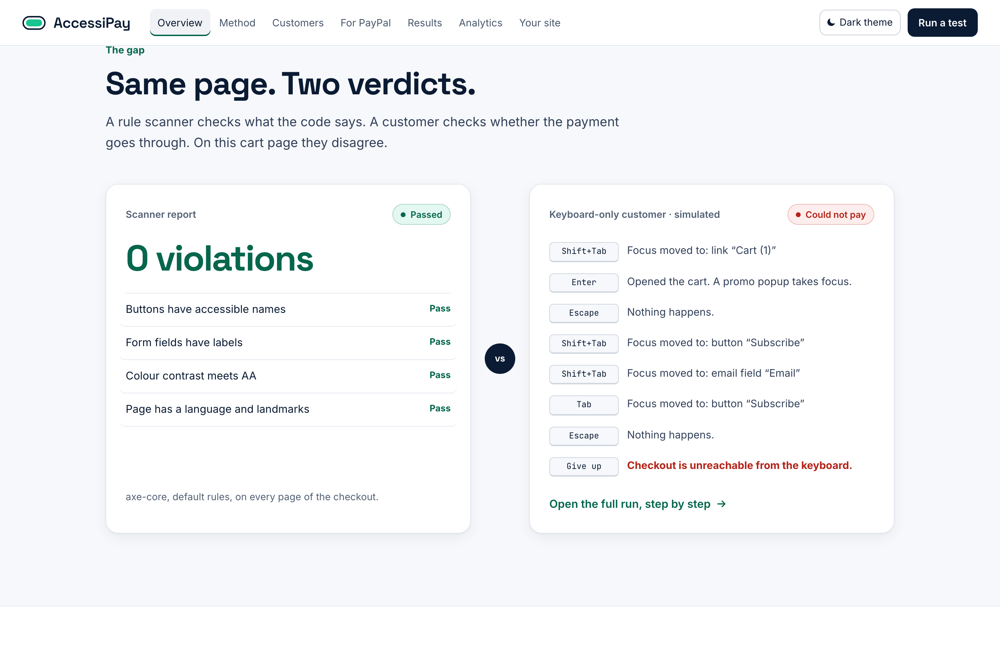

## How it works

<p align="center">
  
</p>

1. **Demo shop.** Five pages (catalog, cart, checkout, payment, confirmation) with thirteen switchable defects (`server/shop/defects.mjs`), split into a train set and a holdout set.
2. **Shoppers.** Three personas, each with its own perception and actions (`server/engine/session.mjs`):
   - *Screen reader user*: gets only the accessibility tree; moves with Tab, Shift+Tab, Enter, Space, arrows, and a screen reader elements list that can jump to focusable controls.
   - *Keyboard-only user*: sees the visible page text; uses only the keyboard.
   - *AI shopping agent*: reads the accessibility tree and acts on elements by role and exact name.
3. **Brain.** Each step is decided by Claude (Claude API), by a Claude Code agent through `tools/agent.mjs`, or by a fixed script in tests.
4. **Oracle.** A run succeeds only when PayPal reports the order as `COMPLETED` (Orders v2). Saying "done" is not enough.
5. **Scanner side.** Every run ends with an axe-core scan of the very same shop, so the console shows "what the scanner says" next to "what actually happened".
6. **Fixer.** For a blocked run, the fixer reads the exact HTML of the page where the shopper stopped plus the transcript, and returns minimal text patches. Each patch must match the page exactly once; the diff is shown, and the same shopper runs again.
7. **Console.** Live run view with the screenshot and the shopper's perception per step, replay, fix panel with diff, and AG Grid tables for runs and defects.

## One case, end to end

The AI shopping agent fills in every card field and then looks for the Pay button, but the button is a `<div>`: it never appears in the accessibility tree. The fixer turns it into a real `<button>`, and the same agent pays.

| | |
|---|---|
| 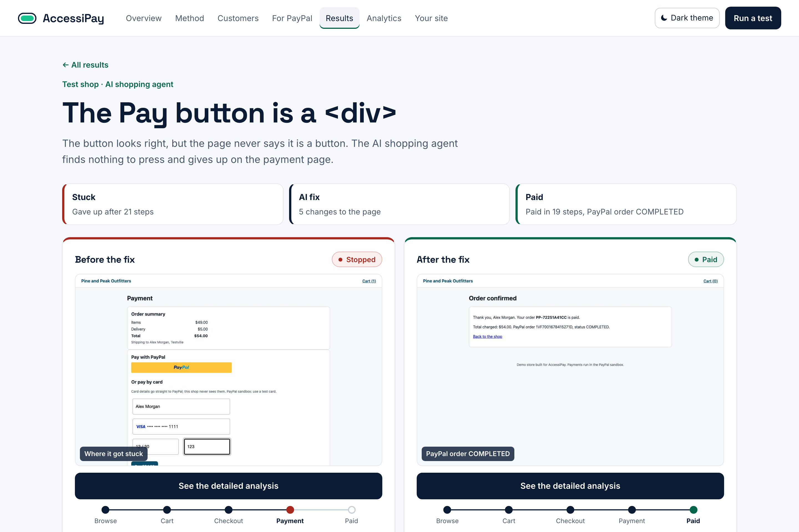 | 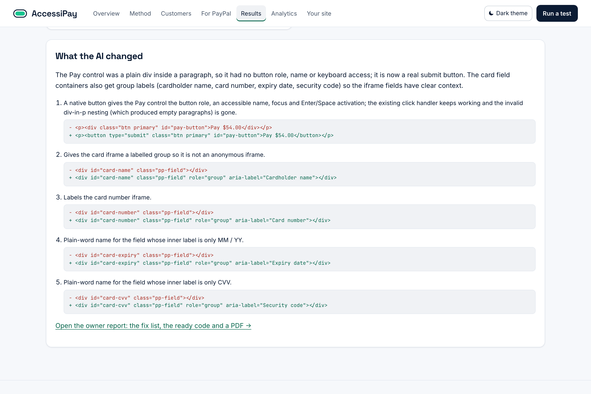 |
| 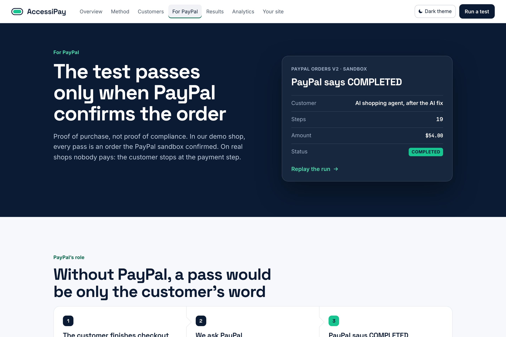 | 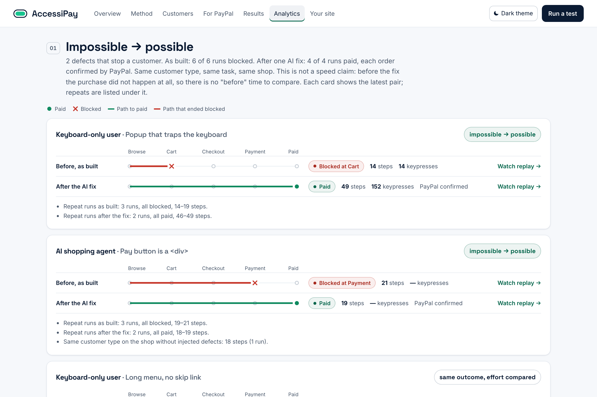 |

Every run can be replayed step by step, with what the customer perceived at each step:

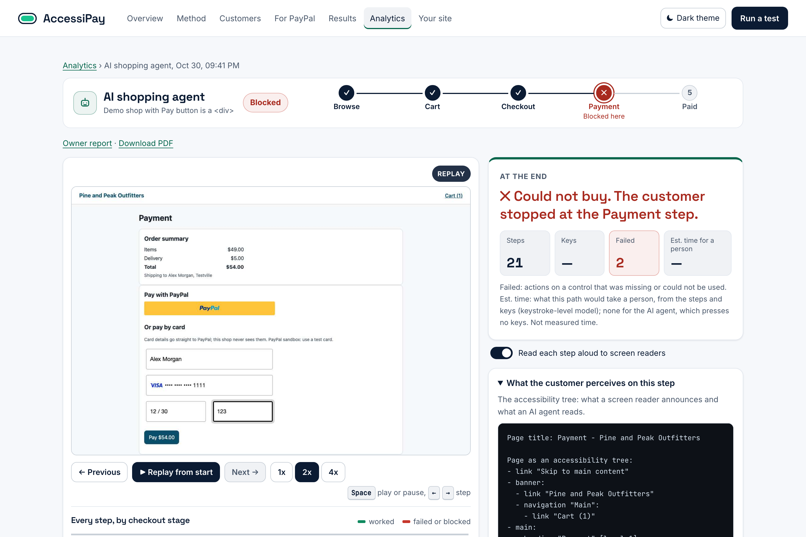

And the owner gets a report with the problem circled on the page, ready code and an accessible PDF:

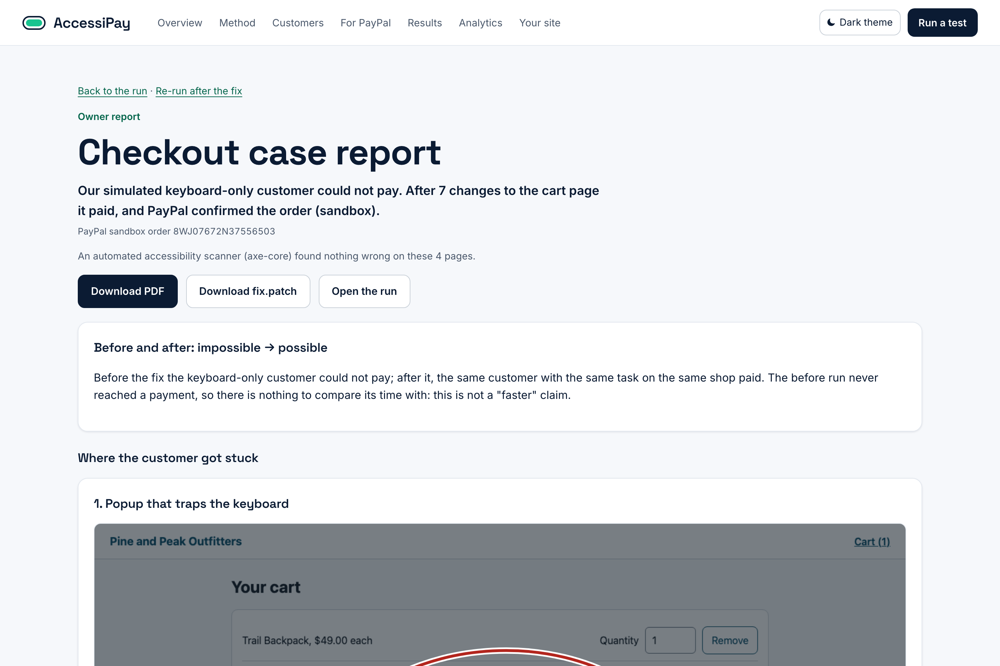

## Results

Measured, not estimated. Runs below used the real PayPal sandbox; the shopper's decisions came from Claude Code agents driving `tools/agent.mjs` (the built-in Claude API brain is implemented but has not been run yet).

Steps are the customer's decisions; the final "give up" or "done" is not counted, the same way the console counts them.

| What | Result |
|---|---|
| axe-core on the 13 defects, one defect per shop | flags 2 (`link-name`, `label`), passes 11 |
| Clean shop, every page | 0 axe-core violations in the shop's own code (axe also reports 4 best-practice notices inside PayPal's hosted card fields; we list those separately) |
| Screen reader shopper, clean shop, paying through PayPal Card Fields | bought it in 36 steps, PayPal sandbox order `COMPLETED` |
| Keyboard-only shopper, promo popup that traps focus (scanner: 0) | blocked on the cart page, gave up after 14 steps |
| Same shopper after the AI fix (7 patches to the cart page) | bought it in 49 steps, order `COMPLETED` |
| AI shopping agent, Pay button made of a `<div>` (scanner: 0) | blocked on the payment page, gave up after 21 steps |
| Same agent after the AI fix (the `<div>` became a `<button>`, plus 4 group names) | bought it in 19 steps, order `COMPLETED` |
| Keyboard-only shopper, 24 category links and no skip link (scanner: 0), 2 runs | paid in 62 and 82 steps, 165 and 198 keypresses |
| Same shopper after the AI fix (one skip link on every page), 2 runs | paid in 52 steps both times, 155 keypresses: medians 28% fewer steps, 15% fewer keys, an estimated 23% less time (keystroke-level model) |
| AI shopping agent, task stated as a need ("keep me dry on hikes, under $100, fast") | chose the Rain Jacket with express delivery, $94.00, order `COMPLETED` |

### Real shops

<p align="center">
  
</p>

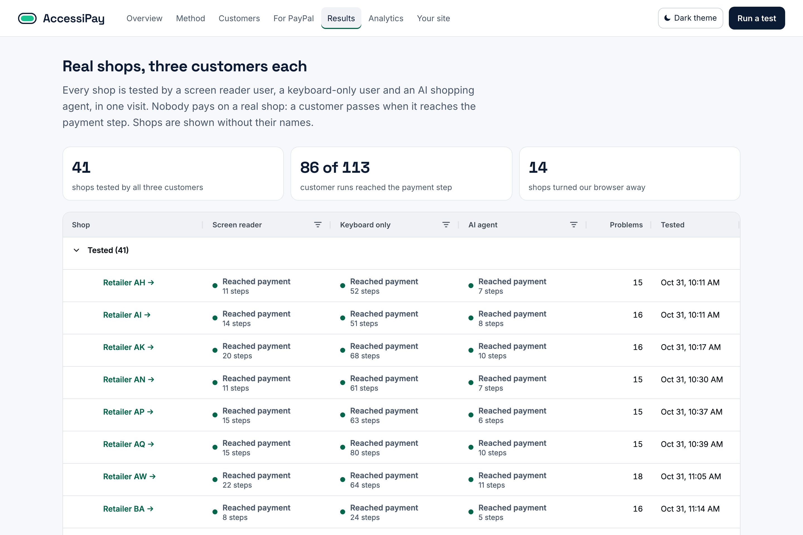


On real sites the shopper goes as far as the payment step and stops: the engine refuses to pay, place an order, type card data, sign in or type passwords, and a network guard blocks anything but reading to payment providers. Before a run it reads robots.txt; a bot check, a maintenance page or HTTP 403/429 ends the run as *not testable*: AccessiPay never tries to get past bot protection. There are at least 3 seconds between actions.

**Every shop gets all three customers, in one visit.** A screen reader user, a keyboard-only user and an AI shopping agent shop at the same time, and their runs are kept together as one analysis of the shop (console: *Results*). A shop is never tested by one customer alone, and the sweep tool (`tools/sweep.mjs`) visits each large retailer at most once a day. Large retailers are published only as *Retailer A*, *Retailer B* and so on: their names, addresses, brand words, screenshots, page text and page addresses are removed from the recorded runs, and capitalised words that are not ordinary English (coined product names such as a jewelry line) are replaced with "[name]" (`server/anonymize.mjs`). The API applies the same mask to runs that are still in progress.

Results of two sweeps on 31 October 2026 (console: *Results*; `node tools/sweep.mjs status`):

| | Shops | Customer runs that reached the payment step |
|---|---|---|
| Tested by all three customers | 41 | 86 of 113 counted runs |
| Screen reader customer | | 37 of 38 |
| AI shopping agent | | 30 of 34 |
| Keyboard-only customer | | 19 of 41 |
| Turned an automated browser away (HTTP 403/429, a bot check, a maintenance page, every Add to cart refused) | 14 | not tested |

All three customers reached payment on 15 shops. Four runs are shown as *not counted* because the fault was ours, not the shop's (a click on a visible control that timed out, a decision that did not arrive in time, a safety rule that took a guest-checkout button for a sign-in); the engine has been fixed for each. Every run that did not reach payment was looked at by hand before it was published: four that had in fact reached the payment step (the methods were buttons, not radio buttons, which the payment check now also counts) were relabelled, and runs stopped by bot protection or by a shop refusing our fictional `example.com` email are listed as not testable, not as accessibility failures.

The keyboard-only customer is the one most often stopped: dozens of tab stops before Add to cart (image galleries, filter lists, long menus without a skip link), cart drawers that open without moving focus into them, an address autocomplete that cannot be used without a mouse. The AI agent was stopped by a cart drawer whose items and Checkout button were missing from the accessibility tree, by size options it could not select and by the same address autocomplete. Across 623 reports on 41 shops, the problems met most often are unnamed or mislabelled controls (40 shops), keyboard focus lost or far away (38), pop-ups and dialogs, cookie banners included, that take over the page (36), and no feedback after an action such as Add to cart (34).

Before publishing, every finding is also checked without AI (below), and the records are checked for names with `node tools/leak-check.mjs`.

Most axe-core issues on these sites are colour contrast and landmark rules; the problems that actually stopped or slowed the customer are mostly different ones.

These runs, the demo shop runs and their fixes are in `data/recorded/` and can be replayed in the console. The full evaluation (every defect, every persona, Claude API, holdout set) is `eval/run-eval.mjs`; its results appear in *Analytics* once it has run.

## Are the findings real?

The customers' findings are written by AI, so every finding is checked again without AI against the record of its run (`server/verify.mjs`, `node tools/verify-findings.mjs`): the page as the customer perceived it at that step (accessibility tree, or visible text and focus for the keyboard customer), where keyboard focus actually went, the status messages on the page after an action, and axe-core on the same page in the same state. A claim about a named control that the record shows with a name is marked as not confirmed.

On the real shops so far: 686 findings; 365 are of a kind that can be checked automatically (controls without a name, identical names, vague names, lost focus, no announcement after an action, empty pages while loading, no skip link, pre-ticked marketing boxes, raw template text); 301 of them (82%) are confirmed by the record (285 by the page record, 16 by axe-core alone) and 64 are not. The other 321 (for example "the price in the cart is higher than on the product card") need a person to judge from the replay. Each finding shows its result in the run view and in the shop's analysis. For a shop whose name is withheld, the check runs before its page text is removed from the record.

## Test your own shop

<p align="center">
  
</p>

Bot protection turns automated browsers away, and AccessiPay never tries to get past it. On their own shop an owner can let it in (console: *Run a test*, "A real shop": after the check, "This is my shop"):

1. **Prove the site is yours**: publish `/.well-known/accessipay.txt` with a code, or add a DNS TXT record `accessipay-verification=<code>`.
2. **Let the checker through**: AccessiPay's browser sends the header `x-accessipay-key: <your key>` on requests to your host and its subdomains, and to no other host. One allow rule in your bot protection (Cloudflare WAF custom rule with the Skip action, Akamai Bot Manager exception, or any firewall) lets those requests in; the protection stays on for everyone else. *Check access* loads your home page with and without the key to confirm.
3. **Optional: pay in your PayPal sandbox**: enter the address of a staging copy of the shop (on the verified domain or a subdomain) that takes payments with a PayPal sandbox app, and that app's Client ID and Secret. AccessiPay asks PayPal's sandbox for a token first, so live keys are refused, and the Secret is never sent back to the browser. The keys are used for one thing: reading orders back.
4. **Send the customers**: all three, screen reader, keyboard-only and AI agent. Without a sandbox they go to the payment step and stop. With it they pay with a PayPal test card, and a run passes only when the owner's sandbox reports an order created during the run as `COMPLETED` (Orders v2 read-back with the owner's keys, so it is their order). During such a run the browser may send a payment only to a PayPal checkout whose JS SDK was loaded with the connected Client ID; any other payment request is blocked. On a verified site the robots.txt rules meant for crawlers are not applied, because the owner asked for the test.

`examples/sandbox-shop` is a separate small shop built to test this flow: its own server, PayPal Buttons and Card Fields on its own sandbox app, and bot protection that turns automated browsers away unless they carry the owner's key. `test/owner-sandbox.test.mjs` runs the whole flow against it (verify, check access, connect the sandbox, pay, read the order back, refund), and checks that a checkout loading PayPal with another Client ID cannot send a payment. Shops on this computer can be tested only with `ACCESSIPAY_LOCAL_SITES=1`.

## Can AI assistants shop here?

A lighter check for any shop: it reads what the shop publishes for AI agents (robots.txt rules for ChatGPT-User, Claude-User, Perplexity-User, GPTBot, ClaudeBot and others; llms.txt; schema.org Product and Offer data) and loads the home page once in an ordinary automated browser. It never sends another company's user agent. Only a rule that names an agent counts as turning it away; a `User-agent: *` rule that keeps the checkout out of search results is reported separately.

The check runs on its own for any address (console: *Run a test*, "A real shop": it runs first when a shop's address is entered), and its result is shown in the shop's analysis when one exists.

## What it does not claim

- It is not a WCAG audit or certificate, and it does not replace testing with real people who use assistive technology.
- The personas are models. The screen reader persona models focus navigation plus an elements list; it does not model browse-mode activation of elements that cannot take focus.
- The thirteen defects were written by us. The holdout set was not used while writing the shopper prompts.
- On real sites tested without their owner the agent stops before paying, so "reached payment" means a payment form or an enabled pay or place-order button was on screen, not that a payment would have succeeded. On one-page checkouts the payment form is on the same page as the address form.
- Shopper decisions in the recorded runs came from Claude models through the engine's agent interface; a different model, or a person, may take more or fewer steps.
- In mock mode no PayPal call is made, and the console says so on every page.

## Run it

```bash
npm install
npx playwright install chromium
npm run build
npm start            # http://127.0.0.1:4300
npm test
```

Environment (`.env` in the project root, never committed):

| Variable | Purpose |
|---|---|
| `PAYPAL_CLIENT_ID`, `PAYPAL_CLIENT_SECRET` | PayPal sandbox REST app. Without them the shop runs in clearly labelled mock mode. |
| `ANTHROPIC_API_KEY` | Claude API for the live shopper and fixer. Without it, runs can be driven by a Claude Code agent. |
| `ACCESSIPAY_MODEL`, `ACCESSIPAY_FIX_MODEL` | Model ids for the shopper and the fixer (default `claude-opus-5-5`). |
| `PORT` | Port of the server (default 4300). |
| `ACCESSIPAY_LOCAL_SITES` | `1` lets owners connect shops on this computer (`localhost`, `*.localhost`): local development and tests only. |

Drive a run with a Claude Code agent or by hand:

```bash
node tools/agent.mjs start screenreader focus-trap-modal   # prints a run id
node tools/agent.mjs turn <run id>                         # instructions and what the shopper perceives
node tools/agent.mjs decide <run id> '{"thought":"...","action":"next","args":{}}'
node tools/agent.mjs fix <run id>                          # fix request for a blocked run
node tools/agent.mjs fix-reply <fix id> reply.json
```

## How PayPal and AI are used

- **PayPal JavaScript SDK** (sandbox): the shop's payment page uses PayPal Buttons and PayPal Card Fields (`components=buttons,card-fields`), so card data goes straight to PayPal and the shop's server never sees it. The keyboard and screen reader customers fill those fields inside PayPal's iframes, as real users do.
- **PayPal Orders v2** (sandbox): the shop's server creates and captures the order, and the read-back of the order decides whether a run succeeded: only `COMPLETED` counts. On an owner's staging shop the read-back uses the owner's own sandbox keys. Verified against the live sandbox: create, capture, read back as `COMPLETED`, refund (`npm test` includes this when sandbox keys are present). Calls go through a token bucket because the sandbox blocks an IP after about 50 requests a minute.
- **Claude**: the shopper's decision at each step (one request per step with a cached persona prompt) and the fixer's patch proposal. Prompts live in `server/engine/prompts.mjs` and `server/fixer/fixer.mjs`.
- **Playwright** drives a real Chromium; **axe-core** is the scanner it is compared with; **AG Grid** powers the runs and defects tables.

## Repository

| Path | What is there |
|---|---|
| `server/engine/` | The shopper engine: personas, sessions, the run loop, brains (Claude API, external agent, script) |
| `server/shop/` | The demo shop and its 13 switchable defects |
| `server/paypal/` | PayPal Orders v2 client (sandbox, or labelled mock mode) |
| `server/fixer/` | The AI fixer and its patch checks |
| `server/report/` | Owner reports: web, accessible PDF, annotated screenshots |
| `server/owners.mjs` | Owner verification, the access key and the PayPal sandbox connection |
| `console/` | The site and console (React, Vite, AG Grid) |
| `examples/sandbox-shop/` | A separate staging shop on its own PayPal sandbox app, for the owner flow |
| `data/recorded/` | Recorded runs and fixes shown on the site (real shops anonymized) |
| `tools/` | Agent seat, sweeps, recording, findings check, leak check |
| `test/` | `npm test`: 40 tests (the 4 that call the PayPal sandbox skip without keys) |

## License

MIT, see `LICENSE`.
